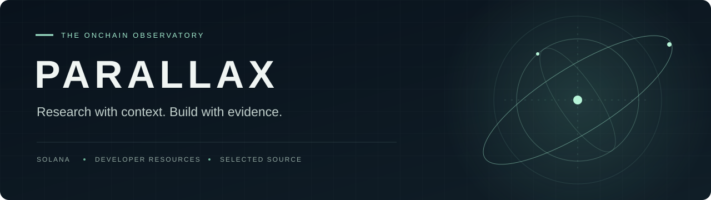

<p align="center">
  
</p>

<p align="center">
  <a href="https://parallaxlaunch.live"><strong>Open PARALLAX</strong></a> ·
  <a href="https://parallaxlaunch.live/docs"><strong>Documentation</strong></a> ·
  <a href="docs/ARCHITECTURE.md"><strong>Architecture</strong></a> ·
  <a href="docs/ROADMAP.md"><strong>Roadmap</strong></a> ·
  <a href="CHANGELOG.md"><strong>Changelog</strong></a>
</p>

# Research with context. Build with evidence.

[](https://github.com/0xMichealDev/Parallax/actions/workflows/ci.yml)

PARALLAX is a Solana research and creator workspace. It brings project research, wallet activity and creator identity into one place, with source links and clear verification boundaries.

This repository is the **PARALLAX developer kit**: selected integration source, executable tests and implementation notes. The hosted platform is available at [parallaxlaunch.live](https://parallaxlaunch.live). The full application is maintained separately.

## The platform

| Workspace | Purpose | Guide |
| --- | --- | --- |
| **Project Passports** | Collect, save and compare token research snapshots with source context. | [Passports](https://parallaxlaunch.live/docs/passports) |
| **Wallet Watch** | Inspect wallet activity and keep saved watches tied to exact addresses. | [Wallet Watch](https://parallaxlaunch.live/docs/wallet-watch) |
| **Project Atlas** | Explore community project profiles and creator identities. | [Creator tools](https://parallaxlaunch.live/docs/creators) |
| **Gold** | Holder access to research assistance, monitoring and membership features. | [Gold membership](https://parallaxlaunch.live/docs/gold) |
| **SolHandle** | Resolve readable handles while independently checking current ownership. | [SolHandle](https://parallaxlaunch.live/docs/solhandle) |

## What you can inspect here

**Ownership resolution.** A read-only SolHandle adapter verifies official records and the current NFT owner through the official SDK. Reverse lookup displays only a valid Primary Handle; an explicit wallet address remains usable when identity enrichment is unavailable.

**Identity lifecycle.** The browser module handles expiry, tab backgrounding, restored pages and delayed responses. A handle transfer cannot silently redirect an existing address-based watch.

**Executable checks.** Fixture tests exercise ownership transfers, invalid records, missing handles, provider failures and browser request races. A provenance check verifies the two extracted production modules against their recorded hashes.

| Directory | Contents |
| --- | --- |
| [`src/`](src/) | SolHandle resolver and input validation |
| [`browser/`](browser/) | Identity-card rendering and refresh lifecycle |
| [`examples/`](examples/) | Read-only mainnet lookup |
| [`tests/`](tests/) | Offline resolver and simulated-browser checks |
| [`docs/`](docs/) | Architecture, API contract, test coverage and roadmap |

## Run the kit

Use **Node.js 22.13 or newer** and npm.

```sh
git clone https://github.com/0xMichealDev/Parallax.git
cd Parallax
npm ci --ignore-scripts
npm run check
```

The check command validates source provenance and runs the offline test suite. No wallet, SOL, account credentials or RPC subscription is required for those checks.

To try a live read:

```sh
node examples/lookup.mjs @solhandle
```

The example reads Solana mainnet without signing transactions. It uses a public RPC endpoint by default; a local `SOLANA_RPC_URL` environment variable can select another provider. Never commit a credential-bearing RPC URL. See the [integration guide](docs/INTEGRATION.md) for the API contract and failure behavior.

## Three independent checks

| Check | Establishes | Does not establish |
| --- | --- | --- |
| **Handle ownership** | A wallet currently owns the official handle asset. | Project permission or token legitimacy. |
| **Wallet control** | A wallet signed a valid proof for an account. | A person's legal identity. |
| **Project authorization** | An account and its required wallet proof may perform a specific operation. | Rights for a future owner of the handle. |

This kit implements identity resolution and display. Wallet proofs and project authorization are enforced by the hosted application and are outside this source preview. Read the [architecture and trust boundaries](docs/ARCHITECTURE.md).

## Development status

The resolver and browser module are extracted from deployed PARALLAX source. [`PROVENANCE.json`](PROVENANCE.json) records their origin and SHA-256 hashes. Test scope and remaining real-device checks are documented in [Testing](docs/TESTING.md).

Joint partner SDK review, an authorized real NFT transfer and iPhone/Phantom signing validation remain outstanding for the broader integration. **Partner Mint is planned.** Track shipped work and future scope in the [roadmap](docs/ROADMAP.md).

## Contribute and report issues

Use the issue templates for reproducible bugs and focused feature proposals. Read [CONTRIBUTING.md](CONTRIBUTING.md) before submitting a change. Suspected vulnerabilities belong in a private reporting channel described in [SECURITY.md](SECURITY.md).

Maintained by **Micheal** · [@0xMichealDev](https://x.com/0xMichealDev)  
[Community](https://t.me/Parallaxcommunity) · [Project updates](https://t.me/parallaxliveupdates)

## License and scope

This is a source preview with **no open-source license granted**. The package is marked `UNLICENSED`; dependency licenses remain their own. Source availability and passing tests are not an independent security audit, a token endorsement or a promise of investment returns.
