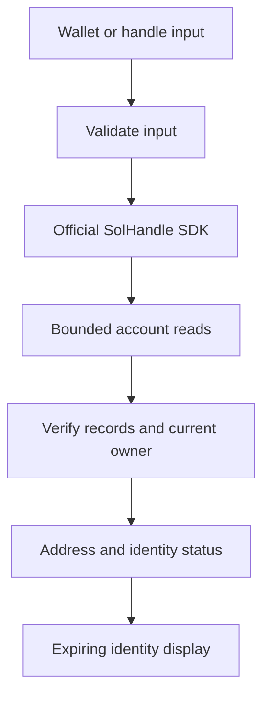

# Architecture and trust boundaries

The kit exposes the identity portion of PARALLAX's SolHandle integration. It does not contain the platform's database, wallet-signature service or project authorization service.

## Resolution path

`src/solhandle.mjs` adapts the official SDK to a caller-provided RPC transport. It permits `getAccountInfo` and `getMultipleAccounts` reads, sets a seven-second lookup budget and does not cache ownership results. The transport should apply its own request cancellation, response limits and provider credential protection.

Forward resolution selects the current owner only after official on-chain records pass SDK checks. Reverse resolution treats the Primary Handle as optional enrichment: a stale record, missing handle or failed provider must never replace an explicit address with an unverified identity.

## Browser lifecycle

`browser/solhandle-identity.js` renders current identity separately from historical research. It:

- Starts the 60-second identity lifetime when a request begins.
- Invalidates displayed identities when the document is backgrounded or leaves the page.
- Rechecks eligible visible cards when the document resumes, including BFCache restoration.
- Rejects responses from an older request revision.
- Retains known addresses when a label expires or a provider is unavailable.
- Deduplicates requests within the current refresh epoch and caps concurrency at two reads.

The module expects same-origin PARALLAX-compatible JSON endpoints. It must not be pointed at arbitrary third-party endpoints without reviewing their response and trust contracts.

## Authorization boundary

| Layer | Responsibility | Included here? |
| --- | --- | --- |
| SolHandle ownership | Check official handle records and current NFT owner. | Yes |
| Browser identity display | Present an expiring name beside its address. | Yes |
| Wallet proof | Validate a signed challenge and its account binding and expiry. | No |
| Project authorization | Check the account, original project wallet and required permissions server-side. | No |

A handle transfer changes a display identity, not an authorization principal. The hosted application's original account and wallet checks remain independent. A browser `canManage` flag is presentation context and must never authorize a server mutation by itself.

## Deployment boundary

The repository contains no backend host, account database or signing flow. Import the resolver into a server you control, supply a bounded RPC reader and implement the browser endpoint contracts only when those endpoints fit your application. The lookup example demonstrates read-only resolution, not a complete production backend.
